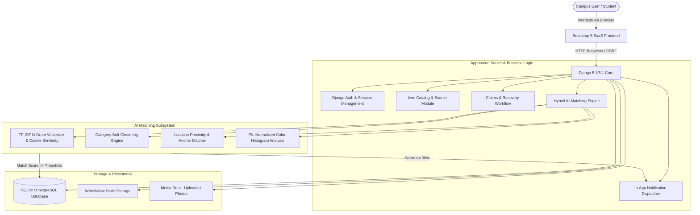
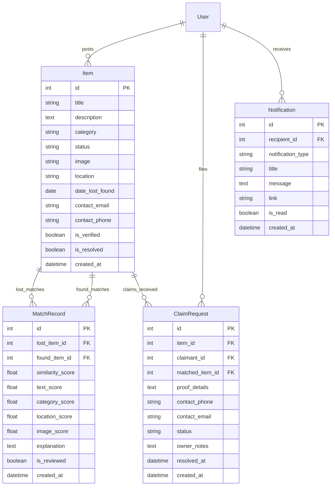

# 🔍 AI-Based Lost-Item Recovery System Using Image and Text Similarity

> **College Minor Degree Project — B.Tech Computer Science & Engineering**  
> **Submission Deadline:** October 15, 2026  
> **Repository:** `gayathriappalreddy23-afk/AI_Based_Lost-Item_Recovery_System`


---

## 📋 Table of Contents

1. [Project Overview](#-project-overview)
2. [Problem Statement](#-problem-statement)
3. [Project Objectives](#-project-objectives)
4. [Existing System vs. Proposed System](#-existing-system-vs-proposed-system)
5. [System Architecture](#-system-architecture)
6. [Technology Stack](#-technology-stack)
7. [AI Matching Engine & Scoring Methodology](#-ai-matching-engine--scoring-methodology)
8. [Database Schema & Data Model](#-database-schema--data-model)
9. [Main Application Modules](#-main-application-modules)
10. [Step-by-Step Installation & Local Setup](#-step-by-step-installation--local-setup)
11. [Environment Configuration](#-environment-configuration)
12. [Automated Testing](#-automated-testing)
13. [Production Deployment Guide (Render)](#-production-deployment-guide-render)
14. [Screenshots](#-screenshots)
15. [Academic Viva & Demonstration Guide](#-academic-viva--demonstration-guide)
16. [Known Limitations & Future Enhancements](#-known-limitations--future-enhancements)

---

## 📖 Project Overview

The **AI-Based Lost-Item Recovery System** is an end-to-end web portal engineered to solve the persistent problem of lost and found personal belongings on university campuses. By integrating full-stack Django architecture with an explainable, multi-feature AI similarity engine, the platform enables students, faculty, and campus security staff to report lost or found items, discover matching candidate listings automatically, file verified ownership claims, and confirm safe handovers.

---

## ❓ Problem Statement

In large university campuses with thousands of daily commuters:
* Lost belongings (laptops, student ID cards, wallets, keys, calculators) are scattered across departments, cafeterias, labs, and sports complexes.
* Traditional recovery methods rely on static WhatsApp groups, unorganized notice boards, or informal security desks with zero search capability.
* Finder and loser descriptions rarely use identical vocabulary (e.g., *"Lost silver laptop"* vs *"Found Dell Inspiron with Intel sticker"*), causing manual listings to be missed.
* Anyone can walk in and claim valuable items without providing verifiable ownership proof.

---

## 🎯 Project Objectives

1. **Centralized Platform:** Unify campus lost and found notices into a searchable, structured catalog.
2. **Intelligent Multi-Signal Matching:** Compute similarity between opposite-status items (`lost` vs `found`) using text TF-IDF vectorization, category alignment, location proximity, and visual color distribution.
3. **Formal Verification & Claim Lifecycle:** Implement a secure claim workflow where claimants must provide private identifying proof before an item is handed over.
4. **Automated Notification Dispatch:** Alert users when potential matches are identified or when claims require review.
5. **Production & Cloud Readiness:** Provide zero-downtime static compilation via WhiteNoise, Gunicorn WSGI serving, and containerized deployment on Render.

---

## ⚖️ Existing System vs. Proposed System

| Parameter | Existing Campus System | Proposed AI Recovery System |
| :--- | :--- | :--- |
| **Medium** | Physical notice boards / WhatsApp chats | Centralized SaaS web platform |
| **Searchability** | Non-existent; manual scroll | Multi-criteria search (keyword, category, location) |
| **Matching** | 100% manual | Automated AI matching across multiple signals |
| **Match Discovery** | Passive; user must remember to check | Proactive in-app match alerts & dashboard notifications |
| **Ownership Proof** | Casual verbal assertion | Structured proof submission (serial no., lock screens, contents) |
| **Status Tracking** | Items remain listed indefinitely | Strict state machine (`active`, `pending claim`, `resolved`) |

---

## 🏗️ System Architecture



---

## 🛠 Technology Stack

* **Backend Framework:** Python 3.10+ / 3.14, Django 5.1 / 6.1
* **AI / Machine Learning:** `scikit-learn` (TfidfVectorizer, cosine_similarity), `numpy`, `Pillow` (PIL image feature extraction)
* **Frontend:** HTML5, CSS3, JavaScript, Bootstrap 5.3, Bootstrap Icons
* **Form Handling:** `django-crispy-forms`, `crispy-bootstrap5`
* **Static Asset Serving:** WhiteNoise 6.6+ with compressed manifest storage
* **Database:** SQLite (local development), PostgreSQL via `dj-database-url` (cloud deployment)
* **WSGI Production Server:** Gunicorn 21.2+
* **Cloud Platform:** Render Web Services

---

## 🤖 AI Matching Engine & Scoring Methodology

The core academic innovation of this project is its **Hybrid Multi-Signal Similarity Engine** located in `items/ai_matching.py`. Rather than relying on simple keyword lookups or treating text cosine similarity as an ungrounded probability, the engine integrates four complementary dimensions:

### 1. Text Similarity ($S_{\text{text}}$) — Weight: 60% – 70%
* **Title Vectorization ($S_{\text{title}}$):** Sublinear TF-IDF with character/word tokenization across item titles (weight: 55% of text score).
* **Description Vectorization ($S_{\text{desc}}$):** TF-IDF vectorization with English stop-word filtering, unigrams, and bigrams $(1, 2)$ (weight: 45% of text score).
$$S_{\text{text}} = 0.55 \cdot S_{\text{title}} + 0.45 \cdot S_{\text{desc}}$$

### 2. Categorical Alignment ($S_{\text{cat}}$) — Weight: 15%
* **Exact match:** 100%
* **Related category group:** 65% (e.g., *Electronics* $\leftrightarrow$ *Accessories*, *Wallet* $\leftrightarrow$ *Bags*)
* **'Other' classification:** 45%
* **Different category:** 20% (soft floor prevents accidental miscategorizations from completely discarding a valid item).

### 3. Campus Location Proximity ($S_{\text{loc}}$) — Weight: 15%
* Token overlap and building anchor matching. For example, *"Central Library 2nd Floor"* $\leftrightarrow$ *"Library Ground Floor"* identifies the common building anchor *"Library"* and awards high baseline proximity ($\ge 53\%$).

### 4. Visual Image Feature Similarity ($S_{\text{img}}$) — Weight: 10%
* Extracts a 96-dimensional normalized RGB color-distribution feature vector using `PIL` and `numpy`.
* Calculates cosine similarity of the color distribution.
* **Dynamic Weighting:** If one or both items lack photos, the engine dynamically shifts image weight to text analysis, ensuring items without photos are never penalized unfairly.

### Composite Score Formula:
$$\text{Composite Score} = 
\begin{cases} 
0.60 \cdot S_{\text{text}} + 0.15 \cdot S_{\text{cat}} + 0.15 \cdot S_{\text{loc}} + 0.10 \cdot S_{\text{img}} & \text{if both photos present} \\ 
0.70 \cdot S_{\text{text}} + 0.15 \cdot S_{\text{cat}} + 0.15 \cdot S_{\text{loc}} & \text{if photos absent} 
\end{cases}$$

---

## 🗄️ Database Schema & Data Model



---

## 📦 Main Application Modules

1. **`items.models`:** Defines `Item`, `MatchRecord`, `ClaimRequest`, and `Notification`.
2. **`items.ai_matching`:** Contains the hybrid scoring algorithms, explanation generator, and background synchronization functions.
3. **`items.views`:** Implements catalog listings, item detail with candidate matches, claim submission and review workflows, and notification dispatch.
4. **`items.forms`:** Validates item creation, image upload sizes ($\le 5\text{MB}$), claim submissions with proof, and claim review notes.
5. **`items.context_processors`:** Globally supplies unread notification and pending claim badges to all templates.

---

## 💻 Step-by-Step Installation & Local Setup

### Prerequisites
* Python 3.10 or higher (Python 3.10 – 3.14 supported)
* Git

### 1. Clone the repository
```bash
git clone https://github.com/gayathriappalreddy23-afk/AI_Based_Lost-Item_Recovery_System.git
cd AI_Based_Lost-Item_Recovery_System
```

### 2. Create and activate a virtual environment
```bash
# Windows
python -m venv venv
.\venv\Scripts\activate

# macOS / Linux
python3 -m venv venv
source venv/bin/activate
```

### 3. Install dependencies
```bash
pip install -r requirements.txt
```

### 4. Navigate to the Django root
```bash
cd campusLostAndFound
```

### 5. Run migrations
```bash
python manage.py migrate
```

### 6. Start the development server
```bash
python manage.py runserver
```
Visit `http://127.0.0.1:8000/` in your browser.

---

## ⚙️ Environment Configuration

Copy `.env.example` to `.env` in the repository root or project directory:
```bash
cp .env.example .env
```
Key configuration parameters:
* `SECRET_KEY`: Long unique secret key string.
* `DEBUG`: `True` for development, `False` for production.
* `ALLOWED_HOSTS`: Comma-separated domains (e.g. `localhost,127.0.0.1,.onrender.com`).
* `CSRF_TRUSTED_ORIGINS`: Comma-separated trusted URL origins.
* `DATABASE_URL`: (Optional) PostgreSQL connection URI for Render or Docker.

---

## 🧪 Automated Testing

A comprehensive suite of 17 automated unit and integration tests verifies authentication, item CRUD permissions, AI scoring accuracy, the claim lifecycle, and dashboard responses.

To execute the test suite:
```bash
python manage.py test items
```
**Expected Result:**
```
Ran 17 tests in ~55s
OK
```

---

## 🚀 Production Deployment Guide (Render)

This repository includes a preconfigured `render.yaml` blueprint and `build.sh` script for Render Web Services.

### Deployment Steps:
1. Push your latest code to GitHub:
   ```bash
   git add .
   git commit -m "Prepare presentation-ready deployment"
   git push origin main
   ```
2. Log in to [Render Dashboard](https://dashboard.render.com/).
3. Click **New +** $\rightarrow$ **Web Service**.
4. Connect your GitHub repository (`gayathriappalreddy23-afk/AI_Based_Lost-Item_Recovery_System`).
5. Configure the service settings:
   * **Root Directory:** *(leave blank / repo root)*
   * **Environment:** `Python 3`
   * **Build Command:** `./build.sh`
   * **Start Command:** `cd campusLostAndFound && gunicorn campusLostAndFound.wsgi:application --bind 0.0.0.0:$PORT`
6. Add the following **Environment Variables** in Render:
   * `DEBUG` = `False`
   * `SECRET_KEY` = *(click Generate or enter a secure random 50-char string)*
   * `ALLOWED_HOSTS` = `.onrender.com`
   * `CSRF_TRUSTED_ORIGINS` = `https://<your-service-name>.onrender.com`
   * `PYTHON_VERSION` = `3.11.8`
7. Click **Create Web Service**. Render will execute `build.sh` (installing dependencies, collecting static files via WhiteNoise, and applying migrations) and launch Gunicorn.

---

## 📸 Screenshots

| Feature | Preview |
| :--- | :--- |
| **Home Dashboard** | `screenshots/home.png` |
| **All Items Directory** | `screenshots/all items.png` |
| **Reported Lost Item** | `screenshots/lost item.png` |
| **Reported Found Item** | `screenshots/found items.png` |
| **AI Suggested Matches** | `screenshots/ai match.png` |

---

## 🎓 Academic Viva & Demonstration Guide

During your Minor Degree Project presentation, structure your demonstration around these key points:

1. **The Core Problem & Architecture:** Explain why traditional campus notices fail and how Django's MVC/MVT architecture coordinates items, claims, notifications, and AI matching.
2. **AI Similarity Pipeline:**
   * Open an item detail page and click **AI Matches Hub**.
   * Show the committee how TF-IDF vectorizes title and description text into numerical feature spaces.
   * Highlight the component breakdown: Text Similarity %, Category Alignment %, Location Proximity %, and Image Color Distribution %.
   * Emphasize that scores are explainable signals rather than black-box guesses.
3. **Claim & Recovery Lifecycle:**
   * Demonstrate reporting a lost item as User A.
   * Switch to User B and show an instant in-app notification alerting them of a potential match.
   * File a claim as User B providing private ownership proof (e.g., serial number).
   * Log back in as User A, inspect the claim under **Claims Center**, review the proof, approve it, and confirm the item marked as **Recovered**.

---

## 🔮 Known Limitations & Future Enhancements

* **Image Matching Scope:** Current image matching analyzes normalized color and luminance histograms to ensure fast, deterministic operation without paid cloud vision APIs or heavy deep learning model weights. Pretrained convolutional embeddings (e.g., MobileNet / ResNet) can be introduced when dedicated GPU infrastructure is provisioned.
* **Real-Time WebSockets:** Match notifications currently leverage database polling and page-refresh contexts. Future versions can introduce Django Channels and Redis for instant WebSocket push notifications.
* **Campus Map Integration:** Geographic coordinates with an interactive Leaflet/OpenStreetMap campus map can complement textual location descriptions.

---

## 👥 Contributors

* **Minor Degree Project Team** — Department of Computer Science & Engineering
* College Minor Degree Project Submission &bull; October 2026
